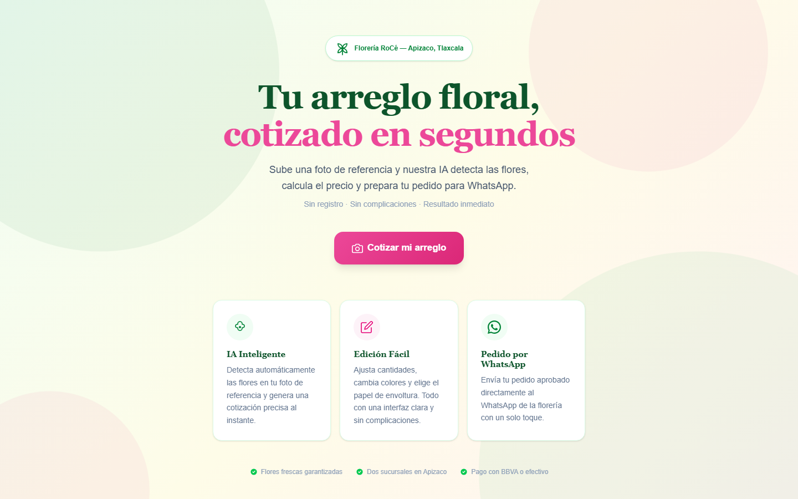
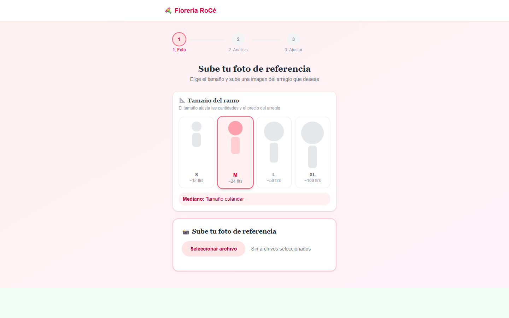
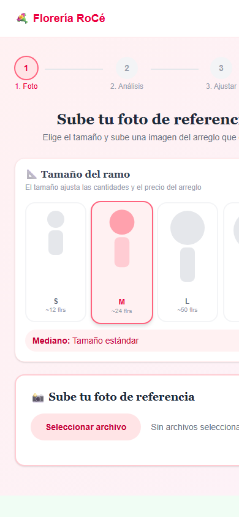

# RoCé Quote — AI Bouquet Quotation from a Photo

[](https://github.com/cantedavid00-afk/floreria-app/actions/workflows/test.yml)


> Personal project for a local flower shop. **Not currently deployed.**



## Overview

A web app where a customer uploads a photo of a bouquet they like and receives an estimated quote based on the shop's real catalog, then sends the order by WhatsApp.

## Business Problem

Customers often send a reference photo and ask "how much would this cost?". Pricing it meant identifying each flower, estimating stems and checking the price list by hand.

## Solution

A vision model lists the flowers, colors and estimated quantities in the photo, guided by the shop's **current inventory**. The backend maps the result to catalog items, suggests substitutes for flowers that are out of stock, applies bouquet size and wrapping paper, and returns an editable quote.

## Key Features

- Image upload with type and size validation (JPG/PNG/WEBP, ≤ 10 MB) → Supabase Storage.
- Vision analysis through GitHub Models (`openai/gpt-4o-mini`, JSON mode), prompted with the live catalog.
- Quote builder (`lib/cotizador.ts`): catalog matching, substitution notices, size and paper.
- Editable quote, accessories and delivery cost by postal code.
- Admin panel to manage flowers, paper, sizes and accessories.
- Daily Vercel Cron job that deletes uploaded images older than 7 days.

## Security

- Admin session stored in an **HMAC-signed, expiring cookie** (`HttpOnly`, `Secure`, `SameSite=Strict`), verified both in `proxy.ts` and inside every `/api/admin/*` handler.
- Password stored as a **PBKDF2 hash**, login rate limiting, cross-origin (CSRF) rejection on mutations, and a safe post-login redirect.
- Fails closed: without `ADMIN_SESSION_SECRET` the admin area stays locked while the public quote flow keeps working.
- Tests: `npm run test:security`.

## Technology Stack

Next.js 16 (App Router, Route Handlers) · React 19 · TypeScript · Tailwind CSS 4 · Supabase (PostgreSQL + Storage) · GitHub Models · Vercel (hosting + Cron).

## Architecture

```mermaid
flowchart LR
  U[Customer browser] -->|photo + size| Q[POST /api/cotizar]
  Q --> S[(Supabase Storage)]
  Q --> CAT[(Catalog tables)]
  Q --> V[GitHub Models vision]
  V --> QB[Quote builder] --> DB[(cotizaciones)]
  ADM[Admin panel] -->|signed session| AAPI[/api/admin/*] --> CAT
```

## Project Structure

```text
app/(public)/cotizador/   quote flow
app/(admin)/admin/        admin panel + login
app/api/cotizar/          main quote endpoint
app/api/admin/*           catalog CRUD (session required)
lib/cotizador.ts          quote rules
lib/admin-session.ts      signed sessions, password hashing, access policy
proxy.ts                  route guard
tests/                    authorization tests
```

## Running Locally

```bash
git clone https://github.com/cantedavid00-afk/floreria-app.git
cd floreria-app
npm install
cp .env.example .env.local   # fill in the values
npm run dev                  # http://localhost:3000
npm run test:security
```

> The Supabase schema is not committed yet (tables: `flores`, `papel_envoltura`, `tamanos_ramo`, `accesorios`, `cotizaciones`, `zonas_envio`, `sucursales`, `catalogo_cp`; bucket `imagenes-cotizaciones`).

## Screenshots

| Quote flow (desktop) | Quote flow (mobile) |
|---|---|
|  |  |
